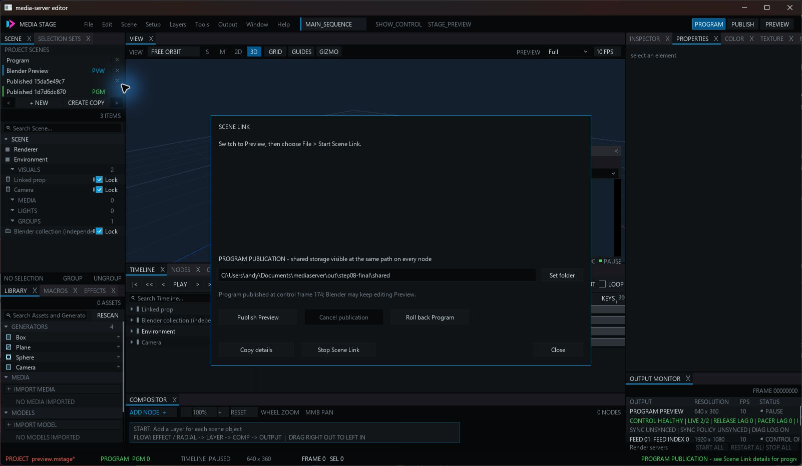
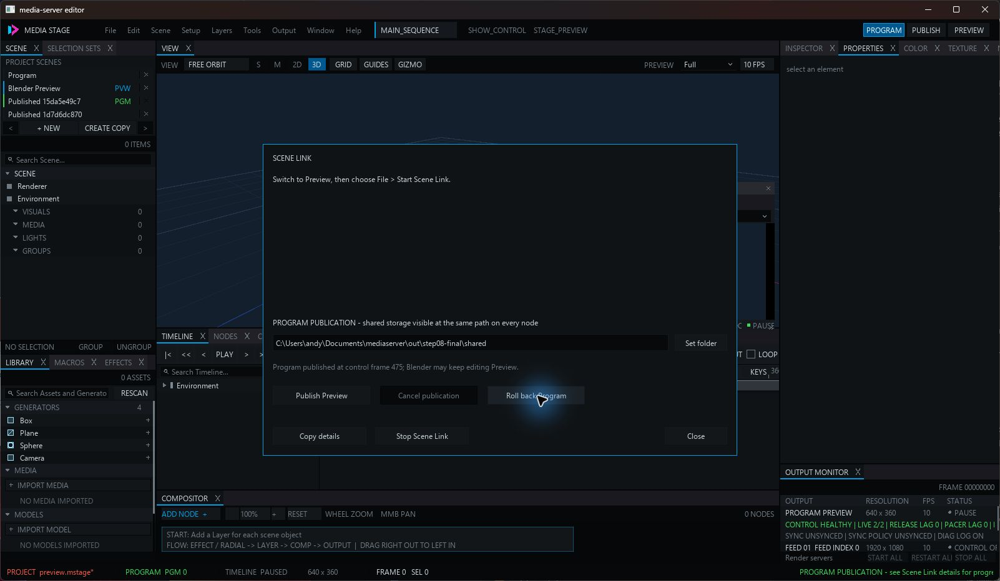
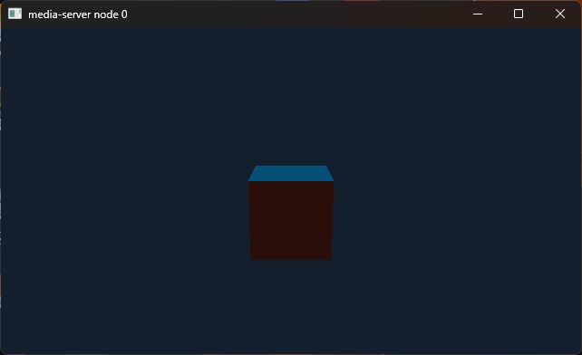
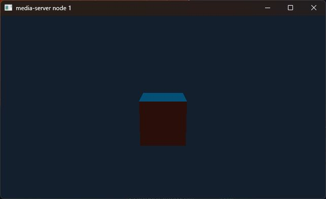
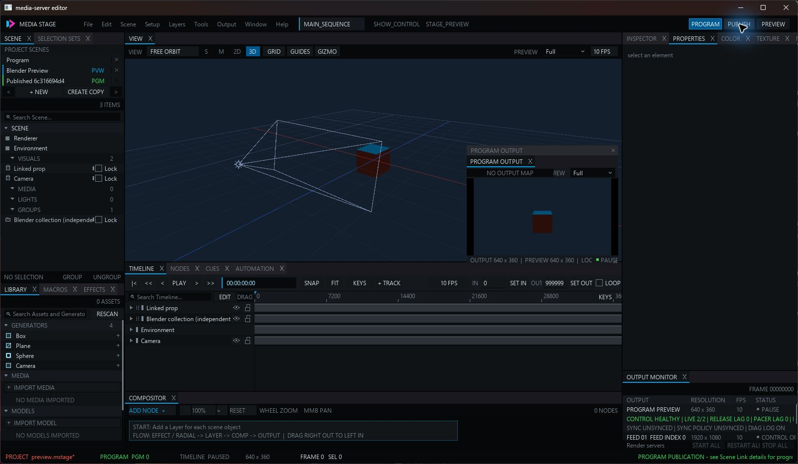

# Step 08 — Program publication checks

## Operator workflow

1. Open the linked Preview project from [step 07](ui-checks-step-07.md). Ensure
   Program and Preview are separate scene slots and all required render servers
   are present in the project hardware configuration.
2. Open **File > Scene Link Details**. Enter an absolute folder in **Program
   storage** and click **Set folder**. Every output node must resolve that exact
   path to the same files. For multiple computers, configure shared storage first.
3. Finish the Blender/Preview change and click **Publish Preview**, or use
   **PUBLISH** beside the Preview control. The panel reports staging, verification,
   cohort readiness, and the scheduled control/show frames. The previous complete
   Program image is held while the replacement prepares.
4. After the cohort accepts the cut, Program is a new **Published ...** scene.
   Preview keeps its linked scene. Continue changing the collection in Blender:
   the accepted Program remains independent. Published scenes are read-only.
5. Before authorization, use **Cancel publication** to keep the current Program,
   or **Publish Preview** again to supersede the candidate. Once the permit is
   scheduled, these controls disable until the cut completes or holds.
6. Use **Roll back Program** in Scene Link Details. It verifies and prepares the
   retained revision through the same cohort gate. On a first take, the previous
   ordinary Program is also saved as a frozen rollback scene.
7. Save and reopen the project with Blender closed. The accepted revision verifies
   from shared storage and reacquires a fresh permit. A saved pending candidate
   is not automatically promoted. Publish again when desired.

Inspect failures in Scene Link Details and the existing asset/renderer readiness
diagnostics. Fix unavailable storage, unsupported source formats or insufficient
capacity, then publish a fresh candidate. A failed node verification is sticky
for that candidate; merely restoring the missing file does not silently retry it.

## Reproducible local demonstration

Build the Debug and Release GUI presets using the repository's normal MSVC
developer environment, then run from the repository root:

```powershell
./scripts/run-blender-publication.ps1 -Build release
```

The script runs the deterministic qualification test, generates an isolated
project/settings directory under `out`, and launches one editor/Director and two
640×360 output processes. It prints their PIDs and log directory. It uses a 10 fps
control cadence to let all three GUI processes share this workstation's GPU.
The top PUBLISH control takes the imported reference prop into Program. Open
Scene Link Details to roll back and publish again. Close these test windows when
finished. `-NoLaunch` generates fixtures and runs the test without opening windows.

## Automated acceptance

`mediaserver.linked_publication` exercises real ingested model packages and a
separate resource row, with two independent verifiers/replicated command buses:

- Remove a staged resource before the second verifier reads it. The ready first
  participant cannot authorize the incomplete cohort.
- Omit a required participant and force a zero-vertex capacity limit. Both cases
  refuse publication and retain the prior image under the existing gate.
- Restore complete readiness. Both command buses switch to the identical frozen
  scene at control frame **40**, show frame **7**, and both gates record frame 40.
  A participant arriving at frame 41 holds under the existing missed-frame policy.
- Apply a Preview edit during the permit lead. The activation transaction retains
  that edit and the published snapshot stays unchanged.
- Check frozen renderer settings, manifest corruption, cancellation, latest-only
  completion, a separately verified rollback snapshot, and save/reopen without
  a Blender connection.

Run it with `ctest --test-dir out/build/windows-msvc-debug-gui -R
linked_publication --output-on-failure`, and repeat for the Release preset.
The separate resource models a transfer dependency; it is deliberately a byte
fixture, so this test does not claim a two-machine textured GPU qualification.

## Native UI evidence

The final Release build was exercised through the Windows editor and two live
output processes. Both output logs confirm the following accepted cuts, with
Blender closed and show frame held at 0:

| Action | Revision prefix | Node 0 visible frame | Node 1 visible frame |
| --- | --- | --- | --- |
| Publish linked Preview | `1d7d6dc8704f` | 174 | 174 |
| Roll back to frozen previous Program | `15da5e49c7f9` | 475 | 475 |
| Return to published prop | `1d7d6dc8704f` | 725 | 725 |

See [full revision, digest and node-log evidence](evidence/step08-final-live.json).
The complete Debug and Release GUI builds succeeded, and all **16 selected
regression tests passed in each configuration**:
[Debug results](evidence/step08-debug-tests.txt),
[Release results](evidence/step08-release-tests.txt).






An earlier local Debug run published revision
`6c316694d46cfe82f878a6779cb6afb653abecf425908a41afae0759155bf995`
at control frame **515**, show frame **0**, asset digest
`9675492506266797511`. Both output logs recorded visible commit **515**.
Rollback reached the previous Program at frame **1566**; returning to the retained
published prop reached frame **2618** on both outputs. Blender was not running.



A separate native disconnect check stopped one required output process. The
existing frame barrier stopped release and retained Program. Cold reconnect with
a new node incarnation did not resume that test session; the local demonstration
was restarted as a complete cohort. That pre-existing recovery path and physical
two-machine/Advanced-renderer performance qualification remain to be tested in
the target stage environment. The shared-GPU Debug run at 50 fps also exercised
missed-frame holds; 10 fps was used for the successful local functional run.

Machine-readable frame/revision evidence and the final Debug/Release regression
results are retained alongside these screenshots in `evidence/step08-*`.
