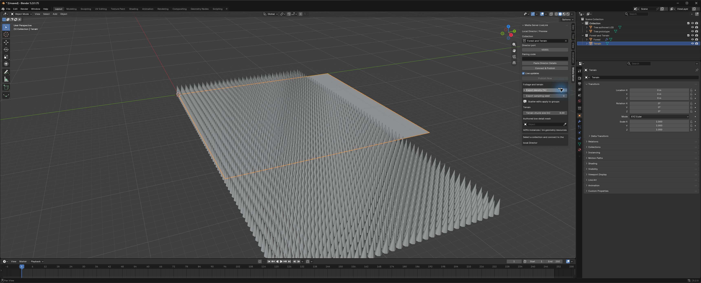
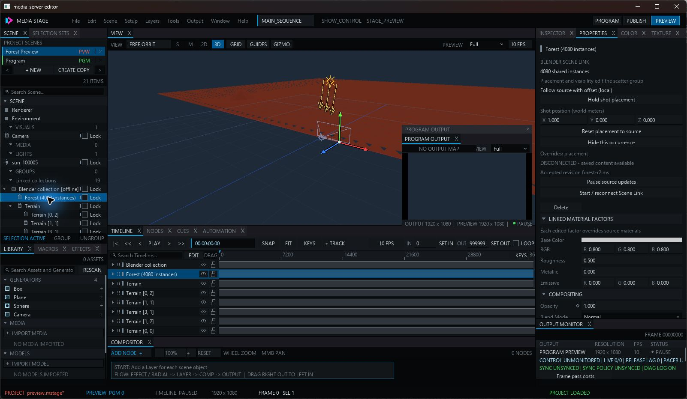
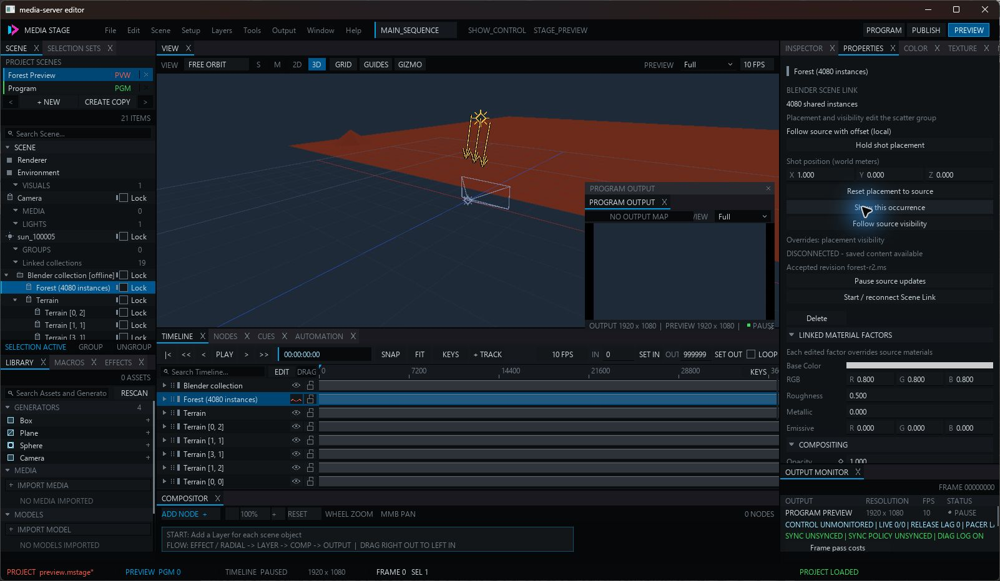

# Step 09 — Foliage and terrain checks

## Try the full-budget Director scene

Build the Debug and Release GUI presets using the repository README, then run
from the repository root:

```powershell
powershell -ExecutionPolicy Bypass -File scripts/run-blender-environment.ps1 -Build release
```

The script generates and qualifies the fixture in an isolated `out/step09-*`
directory, then starts a Director/editor with separate local settings. It prints
the directory and PID. `-NoLaunch` generates evidence without opening a window.

1. Select **Forest Preview** in Project Scenes. The tree has a linked collection,
   **Forest (4080 instances)**, a terrain parent and 16 terrain chunk rows. There
   are 4,096 drawable instances in only 62 document nodes.
2. Select the Forest row. The Inspector reports **4080 shared instances** and
   explains that placement and visibility edit the scatter group. The gizmo is
   at the group origin, and selection uses one aggregate bounds outline.
3. Change **Shot position (world meters)** or use the gizmo to move the group.
   **Hold shot placement**, **Follow source with offset** and **Reset placement
   to source** retain their existing meanings for the complete group.
4. Click **Hide this occurrence**. All trees disappear while terrain remains;
   the row stays available. **Follow source visibility** restores the trees and
   removes the visibility override.
5. Expand Terrain and select a cell. Placement and visibility address that chunk.
   Save/reopen the project to exercise retained packages without Blender.
6. Use the [step 08 publication workflow](ui-checks-step-08.md) to stage and take
   this scene into Program. The same instance, geometry and shadow budgets are
   checked before the existing whole-cohort gate. Program retains a compact frozen
   snapshot; Preview can continue changing.

The generated `published.mstage` is also a ready offline snapshot. Repainting,
reseed, overflow rejection, package reuse and publication replay are automatically
checked before the launcher opens the editor. The launcher is a one-Director UI
demo; the GPU acceptance separately checks both full-camera output slices.

## Try Blender authoring

Package/install add-on 0.4.0 as described in the
[Blender integration README](../integrations/blender/README.md), or start this
disposable factory scene without saving preferences:

```powershell
& 'C:/Program Files/Blender Foundation/Blender 5.2/blender.exe' `
  --factory-startup --python scripts/blender-environment-demo.py
```

1. Dismiss Blender's startup card. Open the 3D View sidebar with **N** and choose
   **Media Server**. The demo has 2,048 mesh-object Geometry Nodes instances,
   an authored tree LOD and a 32×32 metre terrain mesh using 8-metre chunks.
2. Start a Scene Link into a separate empty Preview scene in the Director, copy
   its details, then **Paste Director Details** and **Connect & Publish** in
   Blender. Use a fresh Preview: adding this collection to the already-full
   ceiling fixture correctly exceeds the scene budget.
3. Under **Foliage and terrain**, change **Export density (%)** from 100 to 50.
   The sampling seed field appears. Published instance count drops to roughly
   half plus the terrain, while Blender's viewport retains all 2,048 candidates.
   Change the seed below 100% to select a reproducible different subset.
4. Select Terrain. **Terrain chunk size (m)** is 8. Enter Edit/Sculpt mode, move
   an interior vertex in a single cell, and return to Object Mode. The completed
   revision replaces the affected chunk; unchanged chunks and tree geometry reuse
   their packages. A boundary edit can invalidate adjacent cells as expected.
5. Select Tree prototype to inspect **Authored low detail mesh** and **LOD below
   canvas pixels**. Terrain LODs must preserve every chunk boundary position and
   normal; mismatches refuse the complete revision with a diagnostic.
6. For two-way shot editing, select the real Forest emitter or Terrain parent.
   Generated batch/chunk rows do not create Blender objects or reverse wrappers.
   Individual trees have no persistent shot IDs in this version.
7. Set density to zero and publish, then restore 100. The generated group is
   explicitly removed/orphaned and restored by stable group identity. Generator
   order never remaps an old tree placement to a different tree.

See [Environment scale v1](environment-scale-v1.md) for precise admission limits,
generator requirements, boundary rules and material limitations.

## Recorded qualification

Final Windows Debug and Release GUI builds passed. **Nine focused CTest cases**,
**eight scene/render/editor regression cases**, and **three final UI cases**
passed in each configuration. The final UI tests include a 4,096-instance
selection regression; its viewport suite contains 44 test cases.
The focused Python suites include 12 unit tests. Packaged-addon runs against the
real C++ service passed eight environment checks in both builds, and the existing
bidirectional shot suite passed in both configurations.

| 4,096-instance synthetic fixture | Debug | Release |
| --- | ---: | ---: |
| Document nodes | 62 | 62 |
| Scene evaluation, mean of 20 | 52.28 ms | 2.27 ms |
| Render submission + GPU completion, mean of 5 | 140.80 ms | 16.14 ms |
| Shared vertices / indices | 6,153 / 6,153 | 6,153 / 6,153 |
| Instanced batches | 1 | 1 |
| Authored LOD reductions | 4,080 | 4,080 |
| Directional cascades / casters | 4 / 4,096 | 4 / 4,096 |
| Reported upload bytes | 1,572,992 | 1,572,992 |
| Failed / pending / dropped steady models | 0 / 0 / 0 | 0 / 0 / 0 |

Timings are workstation measurements of a small untextured silhouette dataset,
not a photorealistic vegetation performance promise. Rendering used D3D12 Advanced
at two 320×360 slices of one 640×360 camera, with identical culling/LOD selections.
Publication was checked through two independent verifiers and offline replay;
this run does not claim new physical two-machine timing qualification.

Native UI checks opened both final apps, changed Blender export density to 50%,
verified readable terrain/LOD controls, selected the full Director scatter group,
hid the trees while retaining terrain, and restored source visibility. This found
and fixed the excessive selection-outline drawing cost before completion.





Evidence: [Debug GPU](evidence/step09-debug-gpu.json),
[Release GPU](evidence/step09-release-gpu.json),
[Debug focused tests](evidence/step09-debug-tests.txt),
[Release focused tests](evidence/step09-release-tests.txt),
[Debug regressions](evidence/step09-debug-regressions.txt),
[Release regressions](evidence/step09-release-regressions.txt),
[Debug final UI tests](evidence/step09-debug-ui-tests.txt),
[Release final UI tests](evidence/step09-release-ui-tests.txt),
[Debug Blender](evidence/step09-debug-blender.json),
[Release Blender](evidence/step09-release-blender.json),
[Debug shots](evidence/step09-debug-shot.json),
[Release shots](evidence/step09-release-shot.json).

Reproduce the focused checks with:

```powershell
ctest --test-dir out/build/windows-msvc-debug-gui -R 'mediaserver\.(environment_fixture|environment_unit|linked_environment|linked_environment_gpu|blender_publisher_unit|scene_linked_scene|linked_publication|director_link_service|linked_scene_ingest)$' --output-on-failure
ctest --test-dir out/build/windows-msvc-release-gui -R 'mediaserver\.(environment_fixture|environment_unit|linked_environment|linked_environment_gpu|blender_publisher_unit|scene_linked_scene|linked_publication|director_link_service|linked_scene_ingest)$' --output-on-failure
python scripts/test-blender-livelink.py --build debug --environment
python scripts/test-blender-livelink.py --build release --environment
```
