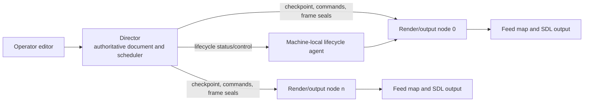

# Media Server Architecture and Delivery Status

This document describes the architecture that is in this repository now, the
contracts it relies on, and the boundaries that are deliberately still open.
It replaces the earlier speculative renderer-selection and multi-year delivery
plan. Media Server remains an early engineering prototype; this is an
implementation-status document, not a compatibility or production-readiness
commitment.

## Product shape

Media Server is a document-driven virtual-production media-server foundation.
A Director owns authoring and control-frame publication. Render/output nodes
receive the same sealed document changes, evaluate the same project state, and
draw only the output mapping assigned to their node index. A one-machine
installation can run all roles; a larger installation separates the Director
and node processes.

The project currently targets LED-wall-style output: large wall-bounded content
is evaluated locally from replicated state rather than sent as full-wall pixel
streams. Adjacent rectangular LED regions are designed to share exact pixel
boundaries, not to rely on cross-node blending. A physical surface or UV warp
can then turn that scene view into a calibrated connector image.

The system has role flags for `director`, `render`, `receiver`, `compositor`,
and `output`. The current executable combines these roles as needed; `render`
and `output` are the practical node pairing in the supplied demos. `receiver`
and `compositor` are role vocabulary and seams for later external/video
pipelines, not evidence that an ST 2110 or NDI receiver exists today.

## Architectural principles

1. **The document is the durable source of authored intent.** Runtime discovery,
   window handles, process state, and machine inventory are transient and never
   overwrite a saved project.
2. **Commands change state at explicit frame boundaries.** The Director assigns
   a target frame, seals the batch, and nodes apply only accepted, ordered
   changes. Render/present code consumes a committed projection, not the live
   document.
3. **Headless model evaluation is first-class.** Scene, output, topology,
   assets, and compositor graph evaluation stay deterministic and independent
   of the GPU/window stack.
4. **Output binding is explicit.** A node selects the feed-map entry for its
   `node_index`; it does not infer a slice from connection order or monitor
   order.
5. **Platform code stays at the edge.** SDL3 owns the current desktop/GPU
   integration. RHI, presenter, decoding, asset loading, and lifecycle-process
   seams contain platform/API-specific behavior.

## Component map

| Area | Current responsibility | Main code |
| --- | --- | --- |
| Core document | Immutable node root, IDs, bounded primitive utilities | `engine/core`, `engine/doc` |
| Command plane | Put/erase commands, revisions, undo/redo, target-frame scheduling, node validation | `engine/cmd`, `engine/wire` |
| Persistence | Atomic `.mstage` files, WAL/release records, recent-project recovery | `engine/persist` |
| Show runtime | Show clock, transport state, Program/Rehearsal switching, frame mailbox and presenters | `engine/show` |
| Network | Framed TCP, FlatBuffers sessions, resume/checkpoint, heartbeat, Director barrier | `engine/net` |
| Authoring projections | Scene/timeline, media/model registry, compositor DAG, feed map, hardware topology | `engine/scene`, `engine/assets`, `engine/compositor`, `engine/output`, `engine/topology` |
| Graphics | SDL GPU-backed Basic renderer; fail-closed Advanced contract, typed capabilities/native handles, render graph, deterministic scene bridge and histories; media/model loaders, compositor executor, output transform | `engine/rhi`, `engine/render`, `engine/shaders`, `engine/ui` |
| Operator surface | Native 2D UI, docking, editor panels, input and file dialogs | `engine/gui`, `engine/editor` |
| Runtime application | Command-line roles, playback loop, persistence startup, lifecycle agent/process host | `apps/server` |

`MEDIASERVER_ENABLE_GUI=OFF` leaves the project, command, persistence, show,
network, scene, output, topology, assets, and compositor model layers
available for headless testing. Enabling GUI adds SDL3, the renderer, native UI,
editor, the media-server application, and GUI-only dependencies including
FFmpeg and import libraries.

## Control, replication, and frame boundaries

### Authoring flow

The editor does not mutate a node's render state in place. It turns each
accepted edit into an ordinary document command with an inverse and history
context. The Director scheduler assigns the command to a future show frame.
At the boundary it seals a command batch, advances the authoritative root, and
publishes the retained sequence to sessions. Undo and redo are Director-local,
per-context stacks: each action schedules fresh inverse commands through that
same path, while a successful new edit clears only that context's redo branch.

Nodes connect through the TCP session service. A joining node receives a
bounded checkpoint/replay sequence and only becomes live when it reaches the
current tail. The node command bus validates command identity, ordering,
fingerprints, cursor lineage, and postconditions before it exposes a committed
root to the playback loop. Digest-bearing evaluated projections make divergent
scene, feed-map, and related state observable in tests and status reporting.

The Director frame barrier tracks the cohort for a sealed frame and
acknowledgements for prepare/commit. With a release authority installed, it
coordinates durable, cursor-bound commit permits; a loss or tracking failure is
reported rather than silently treated as a successful synchronized commit.
Release is held in lockstep with the slowest live node - at most two released
frames may wait for it - while the Director keeps sealing, so editing never
waits on the cluster; a node that lags past the barrier's limit is taken out of
lockstep rather than holding every output. Operator transport anchors also
travel ahead of the frame stream, so a stop reaches a cluster that is behind
(see `cluster-operations.md`, "Lockstep and cluster lag").
This is a control-plane/frame-boundary contract: it answers "are all nodes
working on the same show state?". Whether every physical output presented that
state on the same raster boundary is a separate question, owned by the
synchronization policy, the sync groups derived from the Hardware Map, the
authenticated sync-device reports, and the present-barrier seam described
under "Output synchronization" below. Neither answer is allowed to stand in
for the other.

### Transport and switching

`engine/show` derives show time from a rational-rate `ShowClock` and stores
transport anchors in the document. The Director is the transport authority;
nodes pace their own boundary and present Director-approved frames. Program and
Rehearsal are document scene selections. Rehearsal is cloned and edited in
isolation, then a switcher anchor produces the current short Program dissolve.

Rehearsal's isolation includes time. The replicated transport anchor is
Program's alone; Preview runs a second, Director-local `TransportAuthority`
over the same control-frame stream, authored nowhere, so scrubbing or playing
a rehearsal scene never moves the show. It follows the live range, loop, and
rate, which are one show-wide setting. Compositor graphs are scene-scoped for
the same reason, and a scene copy carries its graph.

### Persistence and recovery

Projects are serialized to checksummed `.mstage` files with atomic replacement.
The Director can retain a WAL, release ledger, and recent-project state. Normal
development playback favors project/edit recovery over promising exact physical
output recovery after a crash. `--durable-frames` records and releases every
sealed frame, including empty frames, for the durable control-path/audit mode.
Startup recovery gives valid recovered WAL state precedence, and damaged or
unreadable recent projects fail closed to safe untitled startup.

## Authored models

### Scene, animation, and assets

The scene model is a deterministic projection of document nodes. It evaluates
geometry, transforms, media quads, imported models, directional/point lights,
materials, layer styles, first-class brightness/saturation/blur effects, and
camera/canvas state for a given show frame. Component channels drive position,
rotation, scale, effects, and other exposed properties. Keyframes preserve
their hold, linear, or cubic interpolation mode in the document view.

A media quad also carries a *placement*: a start frame, a duration, a source
trim, and head/tail opacity ramps, all as exact frame counts. The model
evaluates a clip only inside its own span, maps show frames to source frames
from the clip's own first frame through the same exact rational resampling a
looping clip uses, and multiplies the ramps into whatever opacity was authored
or keyed. A zero duration is the older always-on form, so a project written
before placement existed evaluates identically. The authored placements are
also queryable independently of the playhead, because a timeline has to keep
showing and editing a clip the show has already passed.

Project-wide effect settings - blur kernel taps, sigma ratio, and pass count,
plus the inline-colour response curve and brightness gamma - are a document
node like everything else, resolved lowest-id-wins, clamped once at the model
boundary, carried on the evaluated scene, and covered by the scene digest.
Exposure puts Brightness and Saturation in linear light; Gain puts both in the
encoded/display-referred domain. These are document state rather than machine
preferences precisely because they change the image: two nodes filtering or
responding differently is a divergence, not a local taste.

Assets are a separate, persistent registry. A scene placement refers to an
asset rather than making the library disappear when the placement is deleted.
The registry currently stores exact source paths plus useful probe metadata.
It intentionally does no path canonicalization, bundling, hashing, or
distribution. Therefore every render node must have access to compatible media,
models, and calibration files at the authored path.

### Compositor

The compositor is an authored, typed DAG with bounded capacity and diagnostics.
Its current nodes are Scene Layer, Brightness, Saturation, Levels,
Lift/Gamma/Gain, Contrast/Pivot, Colour Matrix, White Balance, Curves, Film
Grain, Blur, Radial Array, Composite, and Output. Invalid graphs remain visible to the editor but produce
no executable plan. Valid graphs produce an explicit deterministic pass plan;
spatial blur requires an offscreen pass rather than being reduced to a scalar
property. Brightness and Saturation are inline shared-depth processors, while
Blur is isolated. Their fixed domain order is validated across both the
first-class scene stack and downstream graph modifiers, so an active inline
operation authored after Blur fails visibly rather than being silently moved.
Identity nodes do not constrain that order. Film Grain remains slice-stable by
hashing its seed, exact show frame, and authored canvas coordinates rather than
local time or slice-local pixels. The renderer executes the supported
scene/compositor plan today. Brightness and Saturation carry unbounded binary64
products across the scene/graph boundary so clamping and response shaping occur
once over the complete inline stack. The current application seam resolves
modifiers by authored scene-node ID, so validation rejects two Output-reachable
Scene Layer nodes that reference the same source instead of allowing branch
effects to merge. This is still a small starter graph, not a full general-
purpose 2D compositing environment.

Because each layer of that plan renders into its own offscreen target, the
plan also names, per pass, the drawables belonging to other passes that stand
in front of it. Those are rendered for depth only - they write depth and emit
nothing - so an isolated layer is occluded exactly as it would be in a
single-pass render instead of floating in front of the frame. Eligibility is
part of the plan and therefore testable without a GPU: only fully opaque,
Normal-blend, unblurred drawables that some pass of the same plan actually
renders may write depth on another layer's behalf.

### Output and hardware topology

A Feed Map holds one explicit `OutputMap` per node index and optional physical
projection surfaces. It supports:

- a direct slice of the logical scene canvas;
- a planar physical surface with a generalized perspective view;
- a generated horizontal arc, rendered through a projective mesh warp; and
- an imported OBJ/glTF/GLB/FBX UV0 projection mesh, also rendered through a
  projective warp.

For an imported mesh, UV0 is destination/connector space and the mesh path is
an external calibration asset. The renderer does not normalize individual mesh
pieces: calibrated pieces retain a shared stage origin, rotation, and scale.
An invalid or absent map is visibly unmapped rather than guessed.

The Hardware Map is the authored topology of Render Servers, operator machines,
LED processors, walls, typed ports, and cables. Render Servers store a node
index and intended output-window mode/placement. It provides up to 32 stable
logical video-output slots, but current playback launches one feed-map output
per listener/node index; arbitrary mapping of several feeds to physical
connectors is intentionally not complete.

## Graphics and media path

The current graphics stack has an SDL GPU Basic backend and native D3D12
Advanced backend behind `engine/rhi`, with HLSL compiled to both SPIR-V and
DXIL. `engine/render` draws primitives,
imported glTF/GLB/OBJ/FBX geometry, material textures, media quads, lighting, and
the supported compositor/output passes to a GPU target. Lit geometry and media
shaders both execute identity-exact Saturation about Rec.709 luminance in the
project's selected response domain. `engine/ui` presents that target in an SDL
desktop window; `engine/gui` renders the editor's own native draw list and
text/docking UI on the same device seam.

`HybridSceneRenderer` is the host-owned backend boundary. Renderer choice
and required/optional policy are replicated. Basic is explicitly SDL GPU.
Advanced raster uses native D3D12, scene-linear `RGBA16F` composition, and the
complete raster auxiliary set; optional requests report Basic fallback and
required requests fail renderer/Program readiness when that contract is not
available. The boundary carries explicit history identity, padded slice/crop,
deterministic scene-record diffs, and the full advanced product shape. It does
not claim native Vulkan, Spartan ray queries, Atlas DDGI, ReSTIR, denoising,
TAAU, motion blur, or GPU-driven submission. The exact implemented/absent matrix
is [advanced-renderer-status.md](advanced-renderer-status.md), and donor pins
and ownership are recorded in
[third_party/renderer/PROVENANCE.md](third_party/renderer/PROVENANCE.md).

Media decoding is behind `MediaSource`. Numbered image sequences/stills and
FFmpeg-routed video sources decode to CPU pixels, then `MediaCache` manages a
bounded set of GPU textures. Models are similarly loaded behind a renderer
seam. Assets are referenced by absolute path and never copied, with per-machine
presence reported to the operator; this yields a useful local media workflow,
but it does not supply content distribution, byte-level verification across
machines, codec certification, GPU decode, or shared storage orchestration.

The current output transfer is sRGB with native DXGI presentation for scene
windows and SDL desktop presentation as the Basic fallback. The project does
not yet implement OCIO, HDR video output, SDI, NDI, ST 2110,
tracked-camera ICVFX, Notch/Spout, or vendor-specific calibration APIs.

### Output synchronization

Genlock and frame lock align raster boundaries; a present (swap) barrier is
what makes every joined output advance from image N to image N+1 on the same
aligned boundary. Without the barrier two perfectly genlocked outputs can sit
one frame apart indefinitely, so the two are modelled separately throughout.

`engine/sync` owns the authored side: a project-wide `sync.policy` document
node selects UNSYNCED, FRAMELOCK, or EXTERNAL GENLOCK, the required raster and
rational refresh, the vendor swap-group and barrier identifiers, a STRICT or
DEGRADED failure policy, and the late-frame rule. Synchronization groups are
derived from the Hardware Map itself: the set of render-server video outputs
that reach a common downstream processor or wall. Two outputs of one machine
driving unrelated walls are two groups; two machines feeding one processor are
one. Group timing is validated exactly, so 60/1 and 60000/1001 never pass for
each other.

Measurement is split by who can actually observe it. The machine-local
lifecycle agent reports the sync device, the house reference, and each display
target's lock state and timing over its own authenticated message kind, and it
answers while the render child is stopped. The render process reports what
only it can know - whether its swapchains joined the expected present barrier,
and how many frames it presented, missed, ran late, held, or repeated - on the
already-validated node-session heartbeat. Anything unmeasured stays
Unknown/Unsupported; there is no default that means "probably locked".

The late-frame rule is a real behaviour, not a label: under HOLD GROUP a
render process that cannot produce a complete frame for one of its outputs
repeats the previous complete frame on all of them, because one repeated frame
everywhere is far less visible on an LED wall than one segment advancing while
its neighbour stands still.

Program readiness is the conjunction of every gate - exact show frame, adopted
assets, live render nodes, one exact renderer profile and selected backend
across the editor and every mapped output node, compatible group timing, sync
device and reference where the policy asks for them, every group output locked,
and every swapchain joined to the expected barrier. The renderer observation is
the last result of a real record attempt and rides the existing version-3 node
heartbeat; changing any authored renderer setting immediately makes the prior
digest stale. Optional Advanced fallback is safe only when the whole cohort
selects Basic. Until all of that holds, the operator surface names the specific
unmet condition (`RENDERER PROFILE STALE`, `RENDERER BACKEND MISMATCH`,
`SYNC UNVERIFIED`, `REFERENCE LOST`, `SWAP BARRIER INCOMPLETE`,
`DISPLAY TIMING MISMATCH`) instead of a generic green state, and Program
promotion is refused.

Two vendor seams remain unimplemented: `net::ClusterSyncStatusProvider` for a
real sync device (NVIDIA G-Sync via the NVAPI GSync topology/status functions,
and the AMD equivalent), and `rhi::PresentBarrierBackend` to join the native
D3D12 swapchain to an NVAPI present barrier. The D3D12 path now owns and
presents that swapchain but does not claim vendor swap-group membership.
SDL_GPU still exposes no native swapchain handle, which is why the barrier
seam remains a separate installable backend. PTP remains useful
for clock correlation, tracking timestamps, scheduled deadlines, and
telemetry, and replaces neither genlock nor swap lock.

## Operator and machine control

The editor is a native retained/draw-list UI, not the earlier throwaway ImGui
prototype. It offers docking/floating panels; Library import and drag/drop;
Scene/Stage selection, guides, and gizmos; Inspector and Timeline edits;
Compositor editing; Hardware/Feed mapping; output monitoring; and project
open/save.

Lifecycle control is deliberately outside document replication. A machine-local
agent owns exactly one fixed child executable and argument list. The Director
requests only `status`, `start`, `restart`, or `stop` for the expected node
index. Requests use a fresh nonce and HMAC-SHA256 over a key derived from the
render node password (the empty password is a working, unsecured default); child paths and
arguments never travel over the network. The same service publishes a cached,
read-only machine snapshot (process state, host/OS, CPU/RAM, GPU/VRAM, and
active display targets) so offline machines remain diagnosable. It is designed
for a firewalled, trusted control LAN, not an Internet-facing control service.
Each agent also answers an unauthenticated UDP discovery query (port 47839)
with its host name, node index, control port, and whether it has a password;
the editor broadcasts that query on every IPv4 interface and offers what
answers under DETECTED ON NETWORK in Hardware Map, where placing one authors an
ordinary Render Server card. Discovery discloses nothing that grants control,
and queries are padded to the answer size so agents cannot amplify traffic.

## Verification strategy

The project has tests at the boundaries that need deterministic behavior:

- document/command/wire tests for revisions, fingerprints, undo/redo, and codecs;
- persistence and recovery tests for logs, project files, and release records;
- session, resume, heartbeat, barrier, lifecycle, and long-rate soak tests;
- scene, animation, mapping, topology, asset, compositor, and geometry model
  tests that can run without a GPU;
- GPU/readback tests for RHI, media, rendering, output transform, and SDL
  presentation; and
- server bootstrap and panel interaction tests, plus local editor/scene/wall
  demo scripts for manual multi-process verification.

The sustained-rate soak test is built normally but only registered with CTest
when `MEDIASERVER_ENABLE_SOAK_TESTS=ON` because its normal gate is ten minutes.

## Intentional gaps and delivery boundaries

Current renderer behavior and hardware qualification boundaries are recorded
in [capabilities and limits](advanced-renderer-status.md). Camera tracking,
inner-frustum composition, managed color, animation and baked lighting now
have implementation paths; they must not be treated as unimplemented merely
because an early delivery table listed them as future work.

| Area | Remaining boundary |
| --- | --- |
| Assets | General production packaging/transfer and operational content management beyond the linked-scene publication path |
| Outputs | SDI, NDI, ST 2110, pro video interfaces and broader platform/display qualification |
| Synchronization | Physical NVAPI/genlock/present-barrier qualification, PTP correlation and measured photon timing |
| Renderer | Native Vulkan, GPU-driven/bindless/RT features, hardware/driver matrix and product-driven compositor completion |
| Color and tracking | Measured panel/camera calibration, lens agreement and on-stage latency validation |
| Media | Supported-codec performance/reliability matrix and hardware decode where needed |
| Operations | Service installation, observability, secure deployment and recovery on real show networks |
